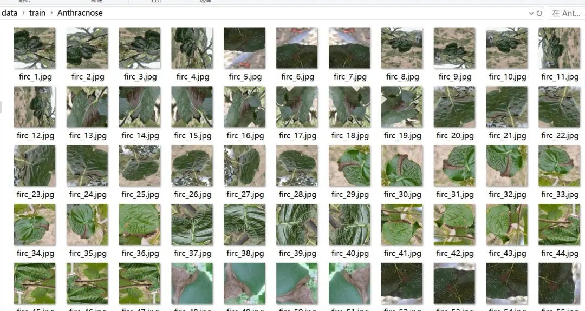
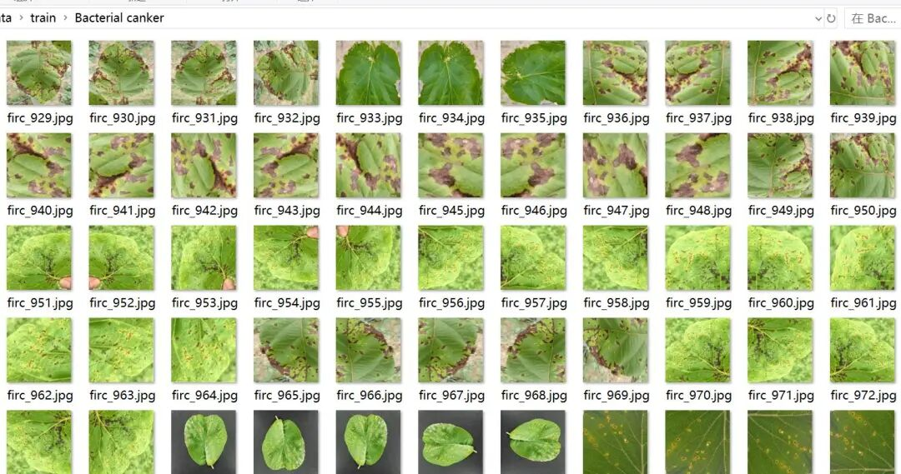
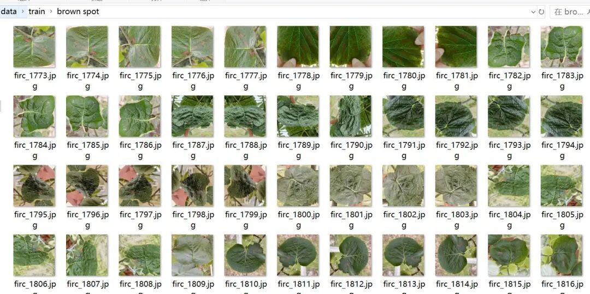
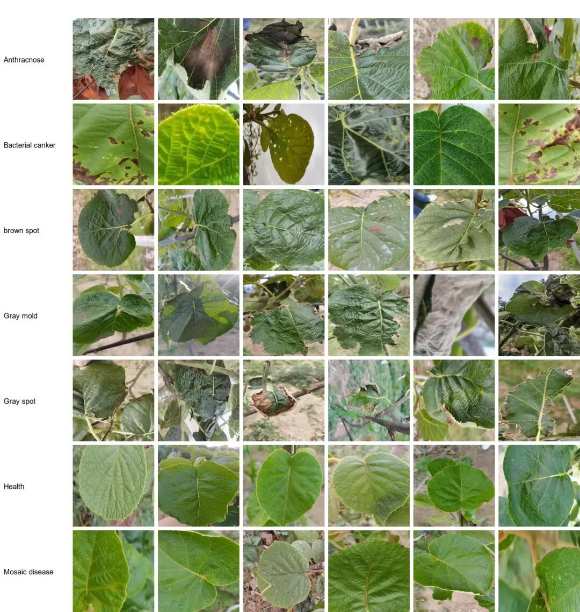

# Wheat leaf disease image classification dataset 9639 images in 7 categories

Dataset type: Image classification, not for object detection without annotations.

Dataset format: Only contains jpg images, each category folder contains the corresponding image.

Number of images (number of jpg files): 9639

Category: 7

Category Name: ['Anthracnose', 'Bacterial canker', 'Gray mold', 'Gray spot', 'Health', 'Mosaic disease', 'brown spot']

Number of images per category:

Number of training set images: 6750

- Anthracnose (anthracnose) training set image count: 928

- Bacterial canker (Bacterial ulcer) training set image count: 844

- Brown spot (Brown Spot Disease) training set image count: 1617

- Gray mold (gray mold) training set image count: 814

- Gray spot (grey spot disease) training set image count: 831

- Health (Health) training set image count: 902

- Mosaic disease (leaf spot) training set image count: 814

Number of validation set images: 2889

- Anthracnose (anthracnose) validation set image count: 397

- Bacterial canker (Bacterial ulcer disease) validation set image count: 361

- Brown spot (Brown Spot Disease) validation set image count: 693

- Gray mold (gray mold) validation set image count: 348

- Gray spot (grey spot disease) validation set image count: 355

- Health (Health) Validation set image count: 386

- Mosaic disease (leaf and flower disease) validation set image count: 349

Test set image count: 0

Total number of images:

- Anthracnose (anthracnose) total image count: 1325

- Bacterial canker (bacterial ulcer disease) total image count: 1205

- Brown spot (Brown Spot Disease) total image count: 2310

- Gray mold (gray mold) total image count: 1162

- Gray spot (grey spot disease) total image count: 1186

- Health (Health) Total Pictures: 1288

- Mosaic disease (leaf and flower disease) total image count: 1163

Important Notice: No

Special : This dataset does not guarantee the accuracy of the trained models or weight files.

Image Preview:

Image example:

## Payment

Here is a pay link on Stripe ( https://buy.stripe.com/3cs8yP7sY87d0vu9AB ). Please contact me lonlonago@foxmail.com after funding $89, and I will send you a complete data files , thank you!

